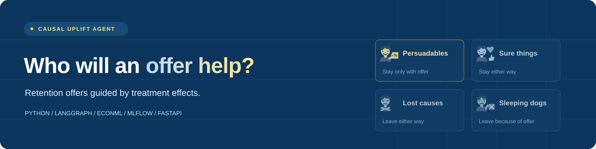
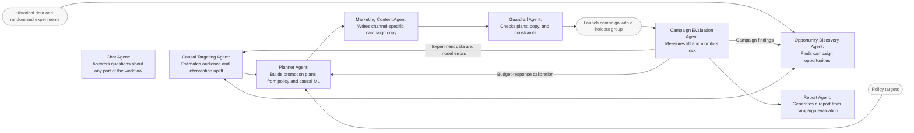

<div align="center">



# Growth Marketing Agents with Causal ML

*LLM agents use causal ML to optimize promotions and drive measurable growth.*


[](https://github.com/huilin-zhang/causal_uplift_agent/actions/workflows/ci.yml)

[](LICENSE)

[Workflow](#workflow) · [Agent Overview](#agent-overview) · [Implementation](#implementation) · [Layout](#layout) · [License](#license)

</div>

---

> [!NOTE]
> **Actively being improved.** The code, results, and documentation are still being refined, so details may change.

Food delivery platforms need to decide whom to target, what to offer, and how to allocate marketing budgets. This project organizes that work into eight agents: causal ML estimates effects, the planner allocates under human policy targets, and people approve campaigns.

The runnable example currently uses the existing subscription-retention simulator and a single promotion intervention. See the [implementation guide](docs/manual/growth_agents_implementation.md) for supported behavior and the remaining PRD work.

<!-- growth-overview:start -->

## Workflow



**How the roles fit together:** The Opportunity Discovery Agent uses historical data and causal estimates to identify campaign opportunities. The Causal Targeting Agent estimates audience and intervention uplift, and the Planner Agent combines these estimates with policy targets to design a promotion experiment. The Marketing Content Agent writes channel-specific copy. Guardrail Agent checks the plan and content, and the campaign launches with a holdout group. The Campaign Evaluation Agent measures lift and monitors risk, and the Report Agent summarizes the results and generates a report. The Chat Agent answers questions about any part of the workflow, including historical data, policy targets, current campaigns, and future plans.


Evaluation data and model errors improve causal targeting, campaign findings guide opportunity discovery, and budget-response calibration refines promotion planning.

## Agent Overview

| Agent | What it does |
|---|---|
| **Opportunity Discovery Agent** | Scans trends and audience signals, validates hypotheses with causal estimates, and prepares briefs with expected lift, cost, and risks. |
| **Causal Targeting Agent** | Before a campaign, estimates the incremental effect of promotion tiers and message attributes for each audience; recommends who to target and what tier to use. |
| **Planner Agent** | Applies business goals, budget, ROI, and user constraints to the proposed user list and promotion tiers; pairs users with messages without re-estimating effects. |
| **Marketing Content Agent** | Drafts email, push, and other channel copy from an approved plan; campaign values are inserted by the workflow.  |
| **Guardrail Agent** | Checks budget, contact frequency, cooldown periods, prohibited claims, brand tone, and consistency of copy with approved numbers; returns failures for revision. |
| **Campaign Evaluation Agent** | After launch, estimates actual lift, confidence intervals, and prediction error against a holdout; returns data to model training and findings to opportunity discovery. It can pause a campaign for serious negative effects. |
| **Report Agent** | After campaign evaluation, summarizes the results and generates a readable report without creating new effect estimates. |
| **Chat Agent** | Answers read-only questions about any part of the workflow, including historical data, policy targets, opportunities, current activity, planned campaigns, messages, guardrails, and evaluation results. |

<!-- growth-overview:end -->

## Implementation

| Part | What's in it |
|:--|:--|
| **Learners** | k-means segments, T-learner, X-learner, causal forest (econml), IPW transformed-outcome learner, plus churn-risk and constant-effect baselines |
| **Metrics** | PEHE, observed and true Qini, policy value at 20% coverage, net value, doubly robust validation loss, stratified bootstrap |
| **Agent** | Eight business roles with deterministic offline defaults; constrained campaign optimization, copy guardrails, explicit approval, randomized holdout, and post-campaign evaluation. Optional Claude wording is numerically checked. |
| **Serving** | FastAPI, Streamlit dashboard, Docker Compose, MLflow model registry with alias-based rollback, GitHub Actions CI with quality gates and a 9-case agent evaluation |

## Layout

```text
app/
├── causal      experiment checks, learners, metrics, bootstrap, benchmark, selector, policy
├── agents      eight business roles, LangGraph orchestration, shared memory/SQL/retrieval tools
├── services    campaign approval and holdout, SQL, knowledge, memory, model registry
├── data        simulation, SQLite store, public dataset loaders
├── api         FastAPI service
└── ui          Streamlit dashboard
pipelines/      pipeline steps, quality gates, agent evaluation
configs/        run settings and simulation parameters
docs/           knowledge cards for retrieval, manuals
infra/          Dockerfile, Airflow DAG
```

## License

[PolyForm Noncommercial 1.0.0](LICENSE). Free for personal, research, and other noncommercial use; commercial use needs separate permission.
