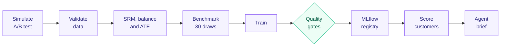

<div align="center">


# Growth Marketing Agents with Causal ML

*LLM agents use causal ML to optimize promotions and drive measurable growth.*


[](https://github.com/huilin-zhang/causal_uplift_agent/actions/workflows/ci.yml)

[](LICENSE)

[Quick start](#quick-start) · [Results](#results) · [Workflow](#workflow) · [Documentation](#documentation) · [Data](#data)

</div>

---

> [!NOTE]
> **Actively being improved.** The code, results, and documentation are still being refined, so details may change.

Food delivery platforms need to decide whom to target, what to offer, and how to allocate marketing budgets. This project organizes that work into eight agents: causal ML estimates effects, the planner allocates under human policy targets, and people approve campaigns.

The runnable example currently uses the existing subscription-retention simulator and a single promotion intervention. See the [implementation guide](docs/manual/growth_agents_implementation.md) for supported behavior and the remaining PRD work.

## Quick start

Requires Python 3.11 or 3.12.

```bash
python -m venv .venv
.venv\Scripts\activate            # macOS/Linux: source .venv/bin/activate
pip install -r requirements.txt
pip install --no-deps -e .
```

Then run:

```bash
python -m pipelines.run_pipeline   # about 7 minutes; set UPLIFT_DRAWS=3 for a 1-minute run
python -m scripts.ask_agent "Plan this month's retention campaign." --trace
uvicorn app.api.main:app --reload  # http://localhost:8000/docs
streamlit run app/ui/streamlit_app.py
```

<details>
<summary><b>🐳 With Docker</b></summary>

```bash
docker compose run --rm pipeline
docker compose up api ui mlflow
```

</details>

## Results

> [!NOTE]
> Historical retention benchmark, before the eight-role workflow update. From one full run (`python -m pipelines.run_pipeline`, 50,000 simulated subscribers, 30 simulation draws, seed 0). The full numbers are in [`artifacts/reports/benchmark_summary.json`](artifacts/reports/benchmark_summary.json).

**🧪 A/B test.** Valid: SRM p = 0.57, largest |SMD| = 0.022. Outreach reduced 30-day churn by an estimated **0.58 pp** (Lin covariate-adjusted, 95% CI 0.05 to 1.11; true simulated effect 0.62 pp). The unadjusted difference in means was 0.76 pp (CI 0.20 to 1.32); Lin is the pre-specified primary estimate.

**🎯 Uplift vs. churn-risk targeting.** In 30 simulated A/B tests with known effects, contacting the top 20% by causal-forest uplift retained a **median 19% more truly incremental customers** than ranking by churn risk (bootstrap 95% CI 9% to 33%; 48.5 vs 40.6 per 3,000 contacts; uplift won in 26 of 30 draws). A single 15,000-row holdout readout could not detect this gain (−2 customers, 95% CI −100 to +87).

<details>
<summary><b>Model comparison and effect recovery</b></summary>

**📊 Model comparison.** On true Qini the X-learner ranked best, then the causal forest and T-learner. Individual effects are only roughly recovered: the causal forest's PEHE (1.61 pp) is just below that of a constant-effect model (1.64 pp).

| Model | True Qini (share of oracle) |
|:--|--:|
| X-learner | 0.55 |
| Causal forest | 0.47 |
| T-learner | 0.46 |
| k-means segments | 0.13 |

</details>

<details>
<summary><b>Offer economics</b></summary>

**💰 Offer list.** On a new simulated cohort the agent proposed 1,239 offers with a true net value of **+$1,638** (model-predicted +$797). Models trained on half the data lost money on average in the benchmark, so this is one example, not a typical result.

</details>

<details>
<summary><b>Non-random assignment</b></summary>

**⚖️ Non-random assignment.** When reps pick who to contact, the naive difference is −11.8 pp. Cross-fitted AIPW gives +0.12 pp (SE 0.35), whose CI covers the true +0.62 pp; weighting brings the largest SMD from 0.78 to 0.04.

</details>

<details>
<summary><b>Public dataset checks</b></summary>

**🌐 Public data.** The estimator selector adapts to each dataset (rare outcomes, unbalanced arms, three arms, 14M rows).

| Dataset | Held-out Qini vs. random |
|:--|:--|
| Hillstrom, women's e-mail | ✅ beats random (causal forest +0.0072, CI +0.0041 to +0.0101) |
| Criteo sample | ➖ borderline |
| Orange telecom churn | ❌ does not beat random |

</details>

## How it works

### Pipeline

Runs weekly via Airflow, or with one command.



The champion alias is updated only when quality gates pass.

<!-- growth-overview:start -->

## Workflow


**How the roles fit together:** The Opportunity Discovery Agent uses historical data and causal estimates to identify campaign opportunities. The Causal Targeting Agent estimates audience and intervention uplift, and the Planner Agent combines these estimates with policy targets to design a promotion experiment. The Marketing Content Agent writes channel-specific copy, the Guardrail Agent checks the plan and content, and the campaign launches with a holdout group. The Campaign Evaluation Agent measures lift and monitors risk, and the Report Agent summarizes the results.

Evaluation data and model errors improve causal targeting, campaign findings guide opportunity discovery, and budget-response calibration refines promotion planning. The Chat Agent answers questions about any part of the workflow, including historical data, policy targets, current campaigns, and future plans.

## Agent Overview

| Agent | What it does |
|---|---|
| **Opportunity Discovery Agent** | Scans trends and audience signals, validates hypotheses with causal estimates, and prepares briefs with expected lift, cost, and risks. |
| **Causal Targeting Agent** | Before a campaign, estimates the incremental effect of promotion tiers and message attributes for each audience; recommends who to target and what tier to use. |
| **Planner Agent** | Applies business goals, budget, ROI, and audience constraints to the proposed list and promotion tiers; pairs audiences with messages without re-estimating effects. |
| **Marketing Content Agent** | Drafts email, push, and other channel copy from an approved plan; campaign values are inserted by the workflow. |
| **Guardrail Agent** | Checks budget, contact frequency, cooldown periods, prohibited claims, brand tone, and consistency of copy with approved numbers; returns failures for revision. |
| **Campaign Evaluation Agent** | After launch, estimates actual lift, confidence intervals, and prediction error against a holdout; returns data to model training and findings to opportunity discovery. It can pause a campaign for serious negative effects. |
| **Report Agent** | After campaign evaluation, turns the evaluation results into a readable report without creating new effect estimates. |
| **Chat Agent** | Answers read-only questions about any part of the workflow, including historical data, policy targets, opportunities, current activity, planned campaigns, messages, guardrails, and evaluation results. |

<!-- growth-overview:end -->

## Implementation

| Part | What's in it |
|:--|:--|
| **Learners** | k-means segments, T-learner, X-learner, causal forest (econml), IPW transformed-outcome learner, plus churn-risk and constant-effect baselines |
| **Metrics** | PEHE, observed and true Qini, policy value at 20% coverage, net value, doubly robust validation loss, stratified bootstrap |
| **Agent** | Eight business roles with deterministic offline defaults; constrained campaign optimization, copy guardrails, explicit approval, randomized holdout, and post-campaign evaluation. Optional Claude wording is numerically checked. |
| **Serving** | FastAPI, Streamlit dashboard, Docker Compose, MLflow model registry with alias-based rollback, GitHub Actions CI with quality gates and a 9-case agent evaluation |

## Documentation

| Guide | Covers | English |
|:--|:--|:--:|
| Operation manual | install, run, check, deploy | [PDF](docs/manual/operation_manual_en.pdf) |
| Code guide | what each module does and why | [PDF](docs/manual/code_guide_en.pdf) |

The PDF manuals describe the original retention benchmark. For current agents, API contracts and implementation limits, use the [growth agents implementation guide](docs/manual/growth_agents_implementation.md). Workflow and Agent Overview above are copied from [the canonical overview](docs/manual/Growth_Marketing_Agents_Overview.md); verify them with `python docs/tools/sync_agent_overview.py --check`.

## Layout

```text
app/
├── causal      experiment checks, learners, metrics, bootstrap, benchmark, selector, policy
├── agents      eight business roles, LangGraph orchestration, shared memory/SQL/retrieval tools
├── services    campaign approval and holdout, SQL, knowledge, memory, model registry
├── data        simulation, SQLite store, public dataset loaders
├── api         FastAPI service
└── ui          Streamlit dashboard
pipelines/      pipeline steps, quality gates, agent evaluation
configs/        run settings and simulation parameters
docs/           knowledge cards for retrieval, manuals
infra/          Dockerfile, Airflow DAG
```

## Data

The main results use simulated data. Three public uplift datasets are used to test estimator selection. They are not included in the repository; download them and place them under `data/external/` (details in the operation manual). Each has its own licence.

| Dataset | Rows | Source page | Direct download |
|:--|--:|:--|:--|
| Orange telecom churn uplift (Verhelst et al., 2023) | 11,896 | [GitHub](https://github.com/TheoVerhelst/Churn-Uplift-Dataset-Paper) | [CSV (Dropbox)](https://www.dropbox.com/s/27kyinnh9jcjdcg/churn_uplift_anonymized.csv?dl=0) |
| Hillstrom MineThatData e-mail test (2008) | 64,000 | [MineThatData blog](https://blog.minethatdata.com/2008/03/minethatdata-e-mail-analytics-and-data.html) | [CSV](http://www.minethatdata.com/Kevin_Hillstrom_MineThatData_E-MailAnalytics_DataMiningChallenge_2008.03.20.csv) |
| Criteo Uplift Prediction v2.1 (Diemert et al., 2018; CC BY-NC-SA 4.0) | 13,979,592 | [Criteo AI Lab](https://ailab.criteo.com/criteo-uplift-prediction-dataset/) | link on the source page (311 MB) |

Where each file goes:

```text
data/external/orange/       Orange CSV
data/external/hillstrom/    Hillstrom CSV
Criteo                      python -m scripts.sample_criteo --source <downloaded file>
```

## License

[PolyForm Noncommercial 1.0.0](LICENSE). Free for personal, research, and other noncommercial use; commercial use needs separate permission.
